# Post-contenido 1 — Unidad 8: Operaciones con Cadenas y Aritmética

**Asignatura:** Arquitectura de Computadores, UFPS
**Estudiante:** Juan Camilo Durán Bohórquez, código 1152532
**Entorno:** NASM 2.16 en formato `bin` para programas `.COM` y DOSBox-X

En este laboratorio el estudiante arma varios programas en ensamblador x86 de 16 bits para modo real. La Parte 1 trabaja las instrucciones de cadena `REP MOVSB`, `REP MOVSW`, `REPNE SCASB`, `REPE CMPSB` y el par `LODSB` con `STOSB`. La Parte 2 trabaja la aritmética de 32 bits con `ADC` y `SBB`, el ajuste BCD empaquetado con `DAA` y `DAS`, una calculadora con `MUL` y `DIV` y el ajuste BCD desempaquetado con `AAA` y `AAS`. El código de cada programa es el que trae la guía del docente, el estudiante lo copia tal cual y cuando algo sale distinto a lo que dice el checkpoint lo deja anotado en vez de cambiarlo. Donde la guía solo da un fragmento para extender un programa, como la resta con `SBB` o la resta con `DAS`, el estudiante pega ese fragmento en el mismo archivo y le agrega lo mínimo para que imprima su mensaje. El único cambio al código de la guía es un signo de dos puntos en la etiqueta `pOp` de `post2c.asm`, sin él NASM no ensambla, y eso se explica en la Parte 2.

## Contenido del repositorio

| Archivo | Parte y paso | Qué hace |
|---|---|---|
| `post1.asm` / `post1.com` | P1, pasos 1 y 2 | Copia una cadena de 13 bytes, primero con `REP MOVSB` y luego con `REP MOVSW` más un `MOVSB` |
| `post1c.asm` / `post1c.com` | P1, paso 3 | Busca la letra d dentro de una cadena con `REPNE SCASB` |
| `post1d.asm` / `post1d.com` | P1, paso 4 | Compara dos pares de cadenas con `REPE CMPSB` |
| `post1e.asm` / `post1e.com` | P1, paso 5 | Copia una cadena y la pasa a mayúsculas con un bucle `LODSB` y `STOSB` |
| `post2.asm` / `post2.com` | P2, pasos 1 y 2 | Suma y resta dos números de 32 bits con `ADD` y `ADC`, y con `SUB` y `SBB` |
| `post2b.asm` / `post2b.com` | P2, pasos 3 y 4 | Suma BCD empaquetada con `DAA` y dos restas con `DAS` |
| `post2c.asm` / `post2c.com` | P2, paso 5 | Calculadora de un dígito con `MUL` y `DIV` y la subrutina `imprimirAX` |
| `post2d.asm` / `post2d.com` | P2, paso 6 | Suma y resta BCD desempaquetada con `AAA` y `AAS` |
| `compilar.bat` | todas | Ensambla los ocho programas de una vez |
| `README.md` | todas | Este informe, con explicaciones, checkpoints y decisiones técnicas |
| `capturas/` | todas | Capturas de compilación y de ejecución de cada checkpoint |

## Compilación y ejecución

Cada programa se ensambla con NASM desde la consola de Windows dentro de la carpeta del repositorio y el `.com` que sale se corre en DOSBox-X con esa misma carpeta montada como unidad C.

```
C:\asm\nasm -f bin post1.asm -o post1.com
post1.com
```

NASM no imprime nada cuando ensambla bien, por eso en las capturas de compilación se ve un `dir` justo después, ahí aparece el `.com` recién creado con su tamaño.

## Estructura general

Todos los programas siguen el mismo molde.

- `ORG 100h` porque el DOS carga los `.COM` a partir del offset 100h, y en un `.COM` código, datos y pila viven en un solo segmento, o sea CS, DS, ES y SS valen lo mismo.
- `section .data` guarda las cadenas y variables y `section .text` el código. En formato `bin` NASM pone `.text` primero, así que el programa arranca en la etiqueta `start`.
- Las etiquetas que empiezan con punto como `.fin`, `.bucle` o `.noHallado` son locales a `start`, eso deja reutilizar nombres cortos sin chocar.
- Todos terminan con INT 21h y AH=4Ch con código de retorno 0.

---

## Parte 1 — Instrucciones de cadena

### Registros implícitos y el flag DF

Las instrucciones de cadena no reciben operandos, todo lo sacan de registros fijos. El estudiante se da cuenta de que casi todo el trabajo del programa es dejar esos registros bien cargados antes de la instrucción.

| Registro | Papel |
|---|---|
| `DS:SI` | Origen, de ahí leen `MOVS`, `LODS` y `CMPS` |
| `ES:DI` | Destino, ahí escriben `MOVS` y `STOS`, y ahí leen `SCAS` y `CMPS` |
| `CX` | Contador de repeticiones cuando hay prefijo `REP`, `REPE` o `REPNE` |
| `AL` | Valor que busca `SCASB`, que carga `LODSB` y que guarda `STOSB` |
| `DF` | Dirección, con `DF=0` SI y DI suben y con `DF=1` bajan |

Como en un `.COM` DS y ES ya apuntan al mismo segmento, igual cada programa copia DS en ES pasando por AX, porque un registro de segmento no acepta un valor inmediato ni una copia directa desde otro segmento. Después de eso todos llaman a `CLD` para dejar `DF=0`. Si DF quedara en 1 por algún programa anterior la copia iría hacia atrás, SI y DI bajarían en cada vuelta y se pisaría memoria que no es del buffer. El estudiante no confía en el valor que trae DF y por eso lo fija siempre.

| Instrucción | Qué hace en cada vuelta | Cuándo para |
|---|---|---|
| `REP MOVSB` | Copia `[DS:SI]` a `[ES:DI]`, avanza SI y DI en 1 y baja CX | CX llega a 0 |
| `REP MOVSW` | Igual pero con 2 bytes, SI y DI avanzan de a 2 | CX llega a 0 |
| `REPNE SCASB` | Compara AL con `[ES:DI]`, avanza DI y baja CX | Encuentra igualdad con ZF=1 o CX llega a 0 |
| `REPE CMPSB` | Compara `[DS:SI]` con `[ES:DI]`, avanza los dos y baja CX | Encuentra diferencia con ZF=0 o CX llega a 0 |
| `LODSB` | Carga `[DS:SI]` en AL y avanza SI | No se repite sola |
| `STOSB` | Guarda AL en `[ES:DI]` y avanza DI | No se repite sola |

### Paso 1, copia con `REP MOVSB` (`post1.asm`)

SI apunta a `origen`, DI apunta a `destino` y CX vale 13, que son los 12 caracteres de `HOLA, MUNDO!` más el nulo. Con una sola instrucción `rep movsb` el procesador copia los 13 bytes y al final SI y DI quedan 13 posiciones más adelante y CX en 0. Luego el programa imprime `msgCop` y `destino` con INT 21h y AH=09h.

### Paso 2, copia optimizada con `REP MOVSW` (`post1.asm`)

El mismo `post1.asm` se cambia para mover palabras de 2 bytes. La longitud 13 se guarda en AX, `shr cx, 1` deja CX en 6, `rep movsw` copia 12 bytes en 6 vueltas y `and ax, 1` revisa si la longitud era impar. Como 13 es impar el resultado no es cero, no salta a `.fin` y un `movsb` suelto copia el byte 13. La idea es hacer la mitad de vueltas, y el resultado en pantalla sale idéntico al del paso 1, que era justo lo que pedía el checkpoint.

**Comportamiento observado en `post1` y `post1e`.** En la pantalla aparece `Copiado: HOLA, MUNDO! Copiado:` con la palabra repetida al final. El estudiante revisa el porqué y es que INT 21h con AH=09h imprime hasta encontrar un signo `$`, pero `destino` termina en el byte nulo copiado del origen y no en `$`. El DOS sigue de largo, muestra el nulo como un espacio y continúa con los bytes que vienen después en memoria, que son justo los de `msgCop`, hasta topar con su `$`. La copia en sí está bien, los 13 bytes de `destino` son iguales a los de `origen`, lo que falla es solo la impresión. Con un `$` en lugar del nulo o con un byte extra con `$` después de `destino` se vería limpio, pero el estudiante deja el código como viene en la guía. En `post1e` pasa lo mismo con `Transformado:`.

### Paso 3, búsqueda con `REPNE SCASB` (`post1c.asm`)

DI apunta a la cadena, AL tiene la letra d y CX vale `longCad`. `repne scasb` va comparando y se detiene en la primera d. Si ZF queda en 0 no la encontró y salta a `.noHallado`. Si la encontró, DI quedó un byte después de la letra, por eso la posición se calcula como DI menos el inicio menos 1.

**Comportamiento observado.** La guía dice que sale la posición 4, pero en DOSBox-X aparece `Hallado en posicion: =`. El estudiante cuenta a mano y la primera d minúscula de Arquitectura de Computadores está en el índice 13, porque Arquitectura ocupa del 0 al 11 y el espacio es el 12. El programa convierte la posición sumando 30h y eso solo sirve para un dígito del 0 al 9, entonces 13 más 30h da 3Dh, que en ASCII es el signo igual. O sea la búsqueda sí funciona y la posición es correcta, lo que no alcanza es la conversión a texto. También se nota que `longCad` vale 29 aunque la cadena tiene 28 letras, así que la búsqueda revisa también el nulo, cosa que no molesta. Para la prueba del carácter inexistente el estudiante cambia temporalmente la letra por z, ensambla, corre y sale `No encontrado.`, después deja el archivo otra vez con la d.

### Paso 4, comparación con `REPE CMPSB` (`post1d.asm`)

SI y DI apuntan a las dos cadenas y CX vale 8, que es el largo de las tres cadenas sin contar el nulo. En el primer caso cad1 y cad2 son iguales, se recorren los 8 bytes, CX llega a 0 con ZF=1 y sale `Iguales.`. En el segundo caso cad1 y cad3 son iguales hasta NASM y el espacio, pero en el índice 5 está la x contra la A. Ahí ZF queda en 0, la repetición para y sale `Diferentes.`. Al parar, SI y DI ya avanzaron un byte más allá de la diferencia y CX quedó en 2, que son los bytes que faltaban por comparar. La guía dice que se detiene en el quinto carácter, el estudiante lo cuenta y en realidad es el sexto si se cuenta desde 1, o el índice 5 si se cuenta desde 0, igual es la x contra la A.

### Paso 5, copia con transformación usando `LODSB` y `STOSB` (`post1e.asm`)

`REP MOVSB` mueve los bytes sin mirarlos, entonces para pasar a mayúsculas toca un bucle a mano. En cada vuelta `lodsb` trae un byte a AL, dos `cmp` revisan si está entre a y z, si lo está `sub al, 20h` lo vuelve mayúscula porque en ASCII la diferencia entre minúscula y mayúscula es justo 20h, y `stosb` lo deja en el destino. `loop .bucle` baja CX y repite mientras no sea 0. La coma, el espacio, el signo de admiración y el nulo no están en el rango y pasan sin cambio. En pantalla sale `Transformado: HOLA, MUNDO!`, con el mismo detalle de impresión del paso 1.

### Checkpoints de la Parte 1

**Checkpoint 1 — Copia con REP MOVSB (`post1.com`)**

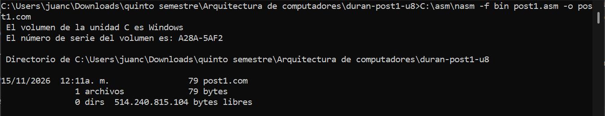
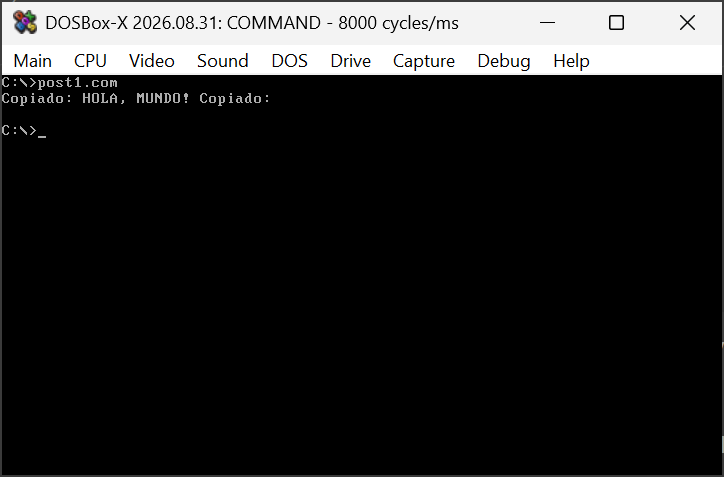

**Checkpoint 2 — Copia optimizada con REP MOVSW (`post1.com`)**


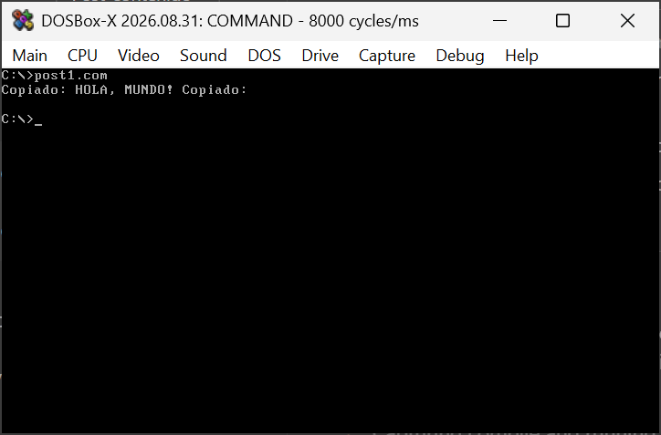

**Checkpoint 3 — Búsqueda con REPNE SCASB (`post1c.com`)**

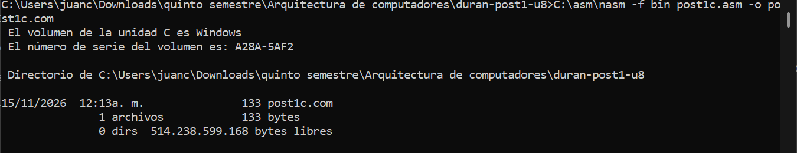
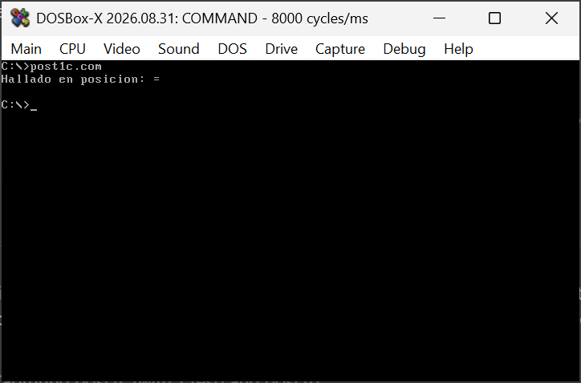
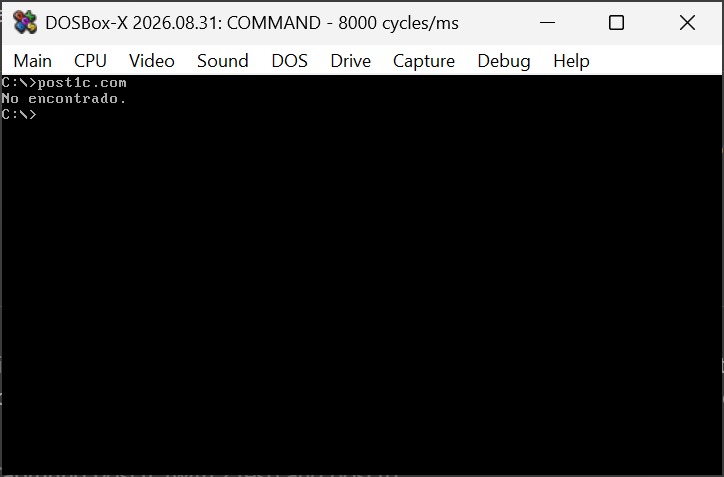

**Checkpoint 4 — Comparación con REPE CMPSB (`post1d.com`)**

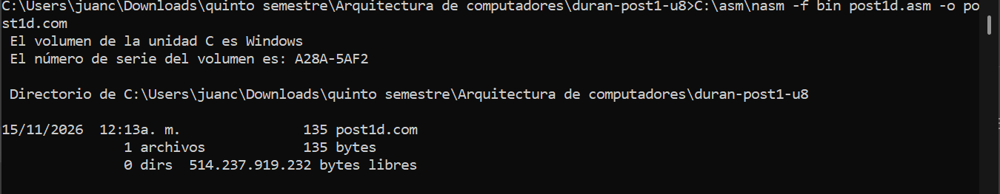
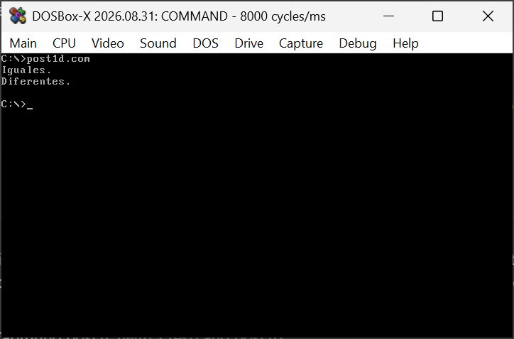

**Checkpoint 5 — Copia con transformación LODSB/STOSB (`post1e.com`)**


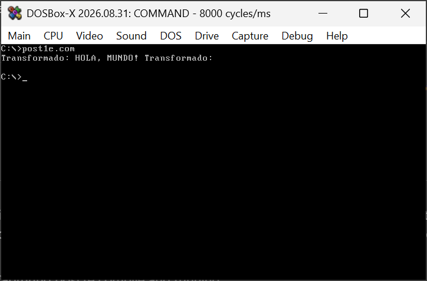

**Checkpoint 6 — Decisiones técnicas de la Parte 1**

### Decisión técnica 1 — ¿REP MOVSB o un bucle manual con LODSB/STOSB?

El estudiante decide usar `REP MOVSB` siempre que la copia sea byte a byte sin tocar los datos, y dejar el bucle con `LODSB` y `STOSB` solo para cuando hay que hacer algo con cada carácter.

`REP MOVSB` es más rápido porque es una sola instrucción que el procesador repite por dentro con su microcódigo. Se decodifica una vez y el propio procesador lleva la cuenta en CX, no tiene que volver a leer instrucciones ni evaluar un salto en cada byte. El bucle de `post1e.asm` en cambio paga en cada vuelta la decodificación de `LODSB`, de los dos `CMP`, de los saltos condicionales, del `SUB`, de `STOSB` y de `LOOP`, más la evaluación de cada condición de salto. Son como seis o siete instrucciones por byte contra una sola instrucción para toda la cadena.

Aun así en `post1e.asm` toca abandonar `REP MOVSB`, porque esa instrucción mueve el byte de memoria a memoria sin pasar por un registro, no hay ningún momento en que el programa pueda mirar el carácter y restarle 20h. Con `LODSB` el byte cae en AL, ahí se revisa y se cambia, y `STOSB` lo escribe ya transformado.

Si la tarea fuera copiar una cadena larga sin ninguna transformación el estudiante seguiría con `REP MOVSB`, o mejor aún con `REP MOVSW` como en el paso 2. Mientras más larga la cadena más pesa el costo repetido de cada vuelta del bucle manual, y no hay nada que ganar a cambio. El bucle manual se justifica solo cuando cada carácter necesita su propia lógica.

### Decisión técnica 2 — ¿CX fijo en REPE CMPSB/REPNE SCASB o verificación manual del terminador?

El estudiante decide que `REPE CMPSB` con CX fijo vale solo cuando las longitudes se conocen al ensamblar, y que para cadenas de largo desconocido hay que revisar el terminador nulo a mano.

Lo primero que nota es que ni `REPE CMPSB` ni `REPNE SCASB` saben qué es un nulo, solo paran por CX o por el flag ZF. Si se comparan con CX=8 una cadena de 5 caracteres y otra de 8, después del quinto byte y del nulo la instrucción sigue leyendo los bytes que estén pegados en memoria a la cadena corta, que pueden ser otra variable, un mensaje o código. Si por casualidad esos bytes coinciden con los de la cadena larga el programa diría que son iguales cuando no lo son, y si no coinciden la posición donde para no significa nada. El resultado queda impredecible y depende de lo que haya en memoria.

Para cadenas de largo desconocido se adapta el bucle de `post1e.asm`. En cada vuelta `LODSB` trae un carácter de la primera cadena a AL, se guarda en otro registro, y se trae el carácter de la segunda cadena con otro `LODSB` cambiando SI o leyendo `[DI]` y avanzando DI. En vez de `STOSB` se comparan los dos. Si son distintos el bucle termina con resultado diferente. Si son iguales y el carácter es 0 las dos cadenas terminaron juntas y son iguales. Si son iguales y no es 0 se sigue. Así el bucle para en el primer nulo de cualquiera de las dos, porque si una termina antes su nulo no va a coincidir con el carácter de la otra.

En `post1d.asm` el CX fijo sí es apropiado porque cad1, cad2 y cad3 son literales del mismo programa y miden exactamente 8 caracteres, eso se sabe desde que se escribe el código. No hay forma de que la instrucción se salga de las cadenas, y por eso ahí la versión rápida no tiene riesgo, cosa que no pasaría con cadenas que llegan del teclado o de un archivo.

---

## Parte 2 — Aritmética de precisión múltiple y BCD

### Los flags que hacen el trabajo, CF y AF

En esta parte casi todo depende de dos flags. El estudiante los ve como el byte de acarreo que pasa de una operación a la siguiente.

| Flag | Se prende cuando | Quién lo usa |
|---|---|---|
| `CF` | Una suma se pasa del tamaño del registro o una resta necesita pedir prestado | `ADC` y `SBB` lo suman o lo restan, `DAA` y `DAS` lo usan y lo dejan prendido si el resultado BCD se pasa de 99 |
| `AF` | Hay acarreo o préstamo del nibble bajo al nibble alto, o sea del bit 3 al bit 4 | `DAA`, `DAS`, `AAA` y `AAS` lo revisan para saber si corrigen el nibble bajo |

### Paso 1, suma de 32 bits con `ADC` (`post2.asm`)

En modo real los registros son de 16 bits, así que un número de 32 bits se guarda partido en dos, la parte alta en DX y la baja en AX. A vale 0001FFFFh y B vale 00010001h. Primero `add ax, bx` suma las partes bajas, FFFFh más 0001h da 0000h y como no cabe en 16 bits se prende CF. Luego `adc dx, cx` suma las partes altas más ese CF, 0001h más 0001h más 1 da 0003h. El resultado `DX:AX` queda en `0003:0000h`, que es 196608, y el programa lo confirma imprimiendo `Suma OK: 0003:0000`. Si en vez de `ADC` se usara otro `ADD` el acarreo se perdería y saldría `0002:0000h`.

### Paso 2, resta de 32 bits con `SBB` (`post2.asm`)

El mismo `post2.asm` sigue después de la suma con una resta. `sub ax, bx` hace 0000h menos 0001h, da FFFFh y prende CF porque tuvo que pedir prestado. `sbb dx, cx` hace 0003h menos 0001h menos ese préstamo, que da 0001h. El resultado `DX:AX` queda en `0001:FFFFh` y sale `Resta OK: 0001:FFFF`. El estudiante pega el fragmento de la guía después de imprimir la suma, le agrega el mensaje `msgRes` y un salto de línea, y deja que la resta use la misma etiqueta `.error` de la suma.

### Paso 3, suma BCD empaquetada con `DAA` (`post2b.asm`)

En BCD empaquetado cada byte guarda dos dígitos decimales, uno por nibble, entonces 47h significa 47 y 38h significa 38. `add al, [bcd2]` suma en binario y da 7Fh, que no es BCD porque F no es un dígito decimal. `daa` mira el nibble bajo, como F es mayor que 9 le suma 6 y queda 85h, luego mira el nibble alto, 8 no pasa de 9 y CF está en 0 así que no lo toca. Para imprimir, `shr al, 4` saca las decenas y `and al, 0Fh` saca las unidades, a cada una se le suma 30h y sale `BCD suma: 85`.

Para comprobar lo que pide el checkpoint el estudiante hace dos pruebas cambiando el archivo un momento y luego lo deja como en la guía. Primero comenta la línea de `daa`, ensambla y corre, y sale `BCD suma: 7?`, el 7 es el nibble alto y el signo de interrogación es F más 30h, o sea 3Fh. Después pone 99h y 01h como operandos y sale `BCD suma: 00`, porque 9Ah se corrige primero a A0h y luego el nibble alto también pasa de 9, se le suman 60h, queda 00h y CF queda en 1 para el siguiente byte BCD. Ese CF no se ve en pantalla pero es lo que dejaría sumar números BCD de varios bytes con `ADC`.

### Paso 4, resta BCD empaquetada con `DAS` (`post2b.asm`)

El fragmento del paso 4 se pega en `post2b.asm` después de la suma, con dos mensajes y una etiqueta `.error`. `sub al, 28h` sobre 73h da 4Bh, que no es BCD, y como el 3 tuvo que pedir prestado al 8 queda AF en 1. `das` le resta 6 al nibble bajo y queda 45h, sale `DAS OK: 45`. En el segundo caso 20h menos 01h da 1Fh, el nibble bajo F pasa de 9, `das` le resta 6 y queda 19h con CF en 0, sale `DAS OK: 19`.

### Paso 5, calculadora con `MUL` y `DIV` (`post2c.asm`)

La calculadora lee cada tecla con INT 21h y AH=01h, que devuelve el ASCII en AL y lo muestra en pantalla. Restarle 30h convierte el carácter del dígito en su valor binario. El primer operando queda en BL, el segundo en CL y el operador en BH.

- Con el asterisco, `mul cl` multiplica AL por CL y deja el resultado completo en AX. Con dígitos del 0 al 9 lo máximo es 81, así que AH queda en 0.
- Con la barra, primero revisa que CL no sea 0. Si es 0 imprime `Division por cero.`, que es justo lo que evita una excepción de división. Si no, deja AH en 0 y `div cl` divide AX entre CL, el cociente queda en AL y el resto en AH. El resto se guarda en la pila y se recupera, pero la guía lo deja sin imprimir.
- `imprimirAX` pasa AX a decimal dividiendo entre 10 varias veces. Cada resto es un dígito, se mete a la pila y se cuenta en CX, y cuando el cociente llega a 0 se sacan de la pila en orden inverso, que es el orden correcto para imprimir, sumando 30h a cada uno.

En DOSBox-X sale `Resultado: 56` para 7 por 8, `Resultado: 3` para 9 entre 3 y `Division por cero.` para 5 entre 0. Las teclas de operación se mandan desde el teclado numérico porque con la distribución de teclado latinoamericana el asterisco y la barra del teclado principal llegan a DOSBox-X como otros símbolos.

**Comportamiento observado.** Tal como está en la guía `post2c.asm` no ensambla. NASM marca la línea 8 con el error `comma, colon, decorator or end of line expected after operand`. El estudiante tarda en ver el problema y es que la etiqueta se llama `pOp`, y como NASM no distingue mayúsculas de minúsculas en los nombres de instrucción la lee como la instrucción `POP` y trata de usar `db` como su operando. Con `pOp:` y los dos puntos NASM entiende que es una etiqueta y ensambla sin cambiar nada más, así que ese es el único arreglo que se le hace al código. Otra opción hubiera sido cambiarle el nombre, pero los dos puntos dejan el resto del programa idéntico. Además la calculadora no valida las teclas, si se escribe una letra en vez de un dígito la resta de 30h da cualquier valor y el resultado no tiene sentido, y si se escribe otro operador solo se imprime `Resultado:` vacío.

### Paso 6, suma y resta BCD desempaquetada con `AAA` y `AAS` (`post2d.asm`)

En BCD desempaquetado cada byte lleva un solo dígito en el nibble bajo y el nibble alto en 0, que es justo lo que queda después de restarle 30h a una tecla. `add al, 08h` con AL en 07h da 0Fh, que no es un dígito válido. `aaa` ve que el nibble bajo pasa de 9, le suma 6 a AL, le suma 1 a AH, prende CF y AF y deja en cero el nibble alto de AL, así que AL queda en 05h y AH debería quedar en 01h. Para la resta, `sub al, 08h` con AL en 03h da FBh, `aas` le resta 6, le resta 1 a AH, prende CF y limpia el nibble alto, y AL queda en 05h. Sale `AAS: 13 - 8 = 5`, que está bien.

**Comportamiento observado.** La suma sale como `AAA: 7 + 8 = :5` y no como 15. El estudiante sospecha de AH y lo prueba comentando la línea de `aaa`, ahí sale `9?`, o sea AH valía 09h y AL 0Fh. El porqué es que justo antes el programa imprime `msgSuma` con `mov ah, 09h` e INT 21h, y AH se queda con ese 09h. `aaa` no pone AH en 0, solo le suma 1, entonces AH pasa a 0Ah y 0Ah más 30h es 3Ah, que en ASCII son los dos puntos. Las unidades sí quedan bien en 5, el ajuste de AAA funciona, lo que sobra es el valor viejo de AH. Con un `xor ah, ah` antes de la suma saldría 15, pero el estudiante deja el código como viene en la guía y lo anota aquí. La resta no tiene ese problema porque solo imprime AL.

### Checkpoints de la Parte 2

**Checkpoint 1 — Suma de 32 bits con ADC (`post2.com`)**


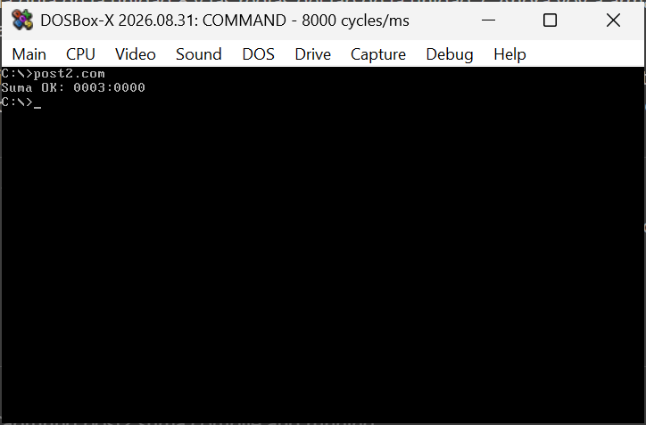

**Checkpoint 2 — Resta de 32 bits con SBB (`post2.com`)**

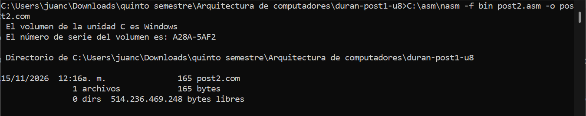
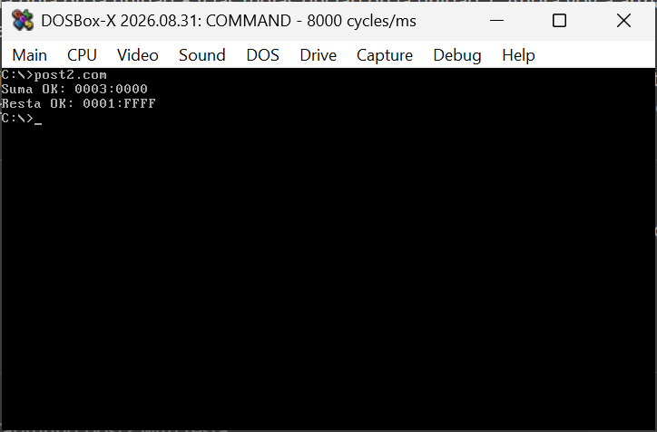

**Checkpoint 3 — Suma BCD con DAA (`post2b.com`)**

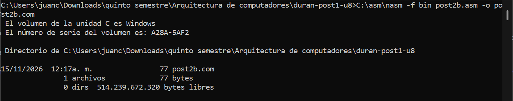
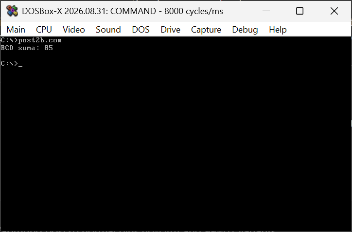
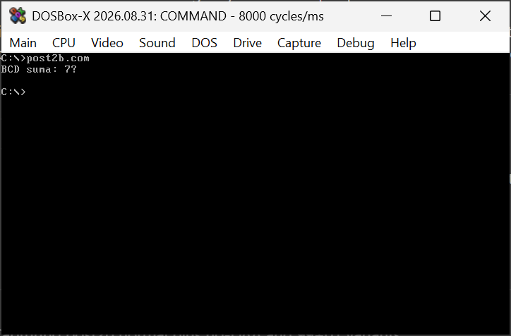
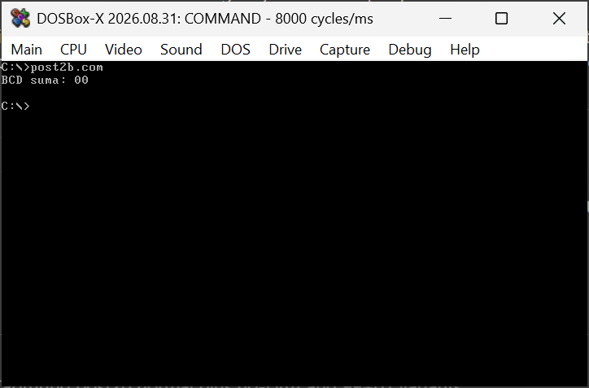

**Checkpoint 4 — Resta BCD con DAS (`post2b.com`)**

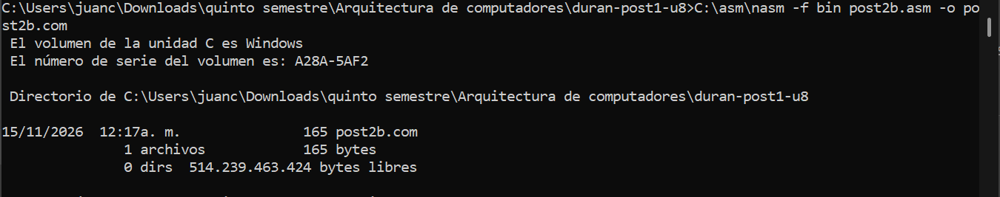
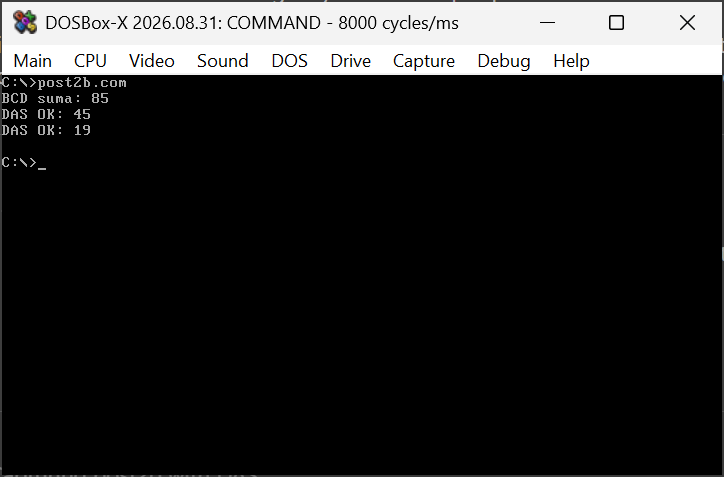

**Checkpoint 5 — Calculadora con MUL/DIV (`post2c.com`)**

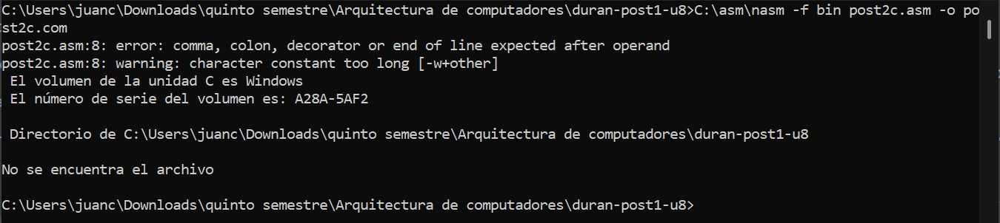
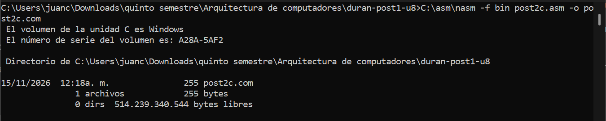
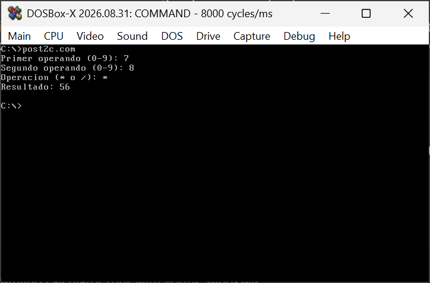
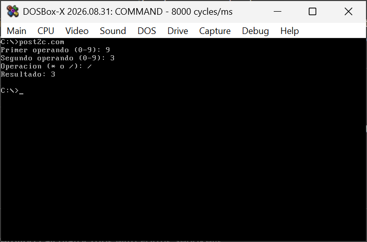
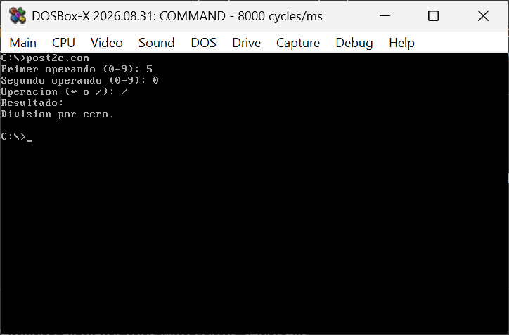

**Checkpoint 6 — Suma y resta BCD desempaquetada con AAA/AAS (`post2d.com`)**


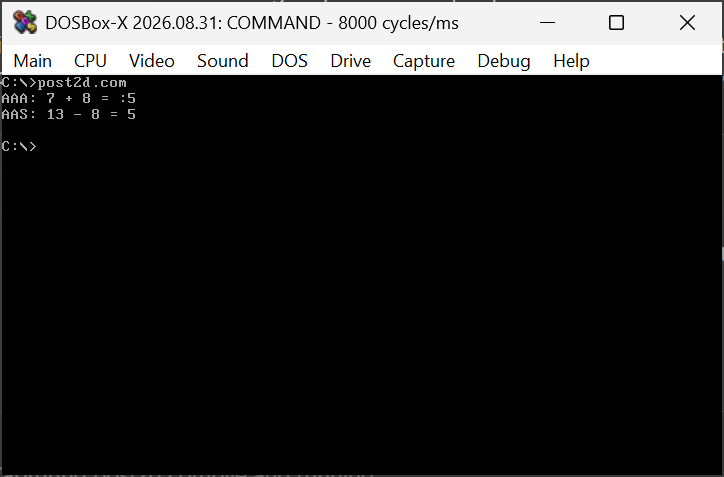
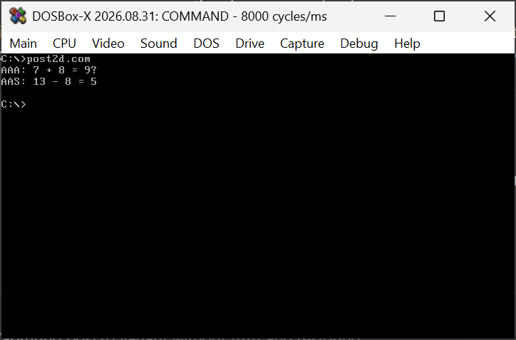

**Checkpoint 7 — Decisiones técnicas de la Parte 2**

### Decisión técnica 3 — ¿DAA/DAS o AAA/AAS según el formato del dato?

El estudiante decide usar `DAA` y `DAS` cuando el dato viene en BCD empaquetado, con dos dígitos por byte, y `AAA` y `AAS` cuando viene desempaquetado, con un dígito por byte y el nibble alto en 0.

La diferencia está en qué nibble ajusta cada una. `DAA` y `DAS` revisan los dos nibbles de AL y suponen que los dos ya son dígitos decimales, por eso pueden sumar o restar 6 al nibble bajo y 60h al alto. `AAA` y `AAS` solo miran el nibble bajo, pasan el acarreo o el préstamo a AH y dejan en cero el nibble alto de AL.

Si llega un byte 47h que significa 47 y se le aplica `AAA` en vez de `DAA`, el nibble alto se borra y el 4 de las decenas se pierde, el resultado queda con un solo dígito y ya no representa el número. Por eso con datos empaquetados solo sirve `DAA`.

En la calculadora de `post2c.asm` cada tecla queda como un dígito en AL con el nibble alto en 0, eso es BCD desempaquetado. Si esa calculadora sumara dos dígitos sin `MUL` ni `DIV`, el ajuste correcto sería `AAA`, porque deja las unidades en AL y la decena en AH, listas para sumarles 30h e imprimirlas.

Si se usara `DAA` sobre 07h más 08h, que da 0Fh, la instrucción tomaría ese 0 del nibble alto como si fuera un dígito de decenas, le sumaría 6 al nibble bajo y daría 15h en un solo byte, que es 15 pero empaquetado. AH no se entera de nada, y el código que espera la decena en AH y las unidades en AL imprimiría un valor equivocado.

### Decisión técnica 4 — ¿ADC de precisión fija o una cadena de ADC en bucle?

El estudiante decide que para 32 bits la versión fija de `post2.asm` es la mejor, y que para números más grandes o de tamaño variable conviene un bucle con `ADC`.

Para generalizar la suma a N palabras se guardan los dos números en memoria como arreglos de palabras, de la de menor peso a la de mayor peso. SI apunta al primer número, DI al segundo, BX al resultado y CX vale N. Antes del bucle se hace `CLC` para dejar CF en 0. En cada vuelta se carga una palabra en AX, se le hace `ADC` con la palabra del otro número, se guarda el resultado y se avanzan los punteros de a 2, cuidando de usar instrucciones como `INC` o `LEA` que no tocan CF, porque si un `ADD` de punteros borra CF se pierde el acarreo. `LOOP` tampoco toca los flags, así que sirve para cerrar el bucle.

La primera palabra va con `ADD` en la versión fija porque no hay ningún acarreo anterior que sumar, y si se usara `ADC` se sumaría lo que haya quedado en CF de cualquier operación vieja. Las siguientes van con `ADC` porque cada una tiene que recibir el acarreo de la anterior. En el bucle se logra lo mismo con `CLC` antes de entrar y `ADC` en todas las vueltas.

La ventaja del bucle es que se mantiene fácil, el mismo código suma 48, 64 o 1024 bits cambiando solo N, como un tipo bignum. La desventaja es el rendimiento, cada palabra paga cargar, sumar, guardar, mover punteros y evaluar el salto, contra dos instrucciones en `post2.asm`. Es lo mismo que pasa en la Parte 1 entre el bucle con `LODSB` y `STOSB`, más flexible, y `REP MOVSB`, más rápido.

---

## Referencias

The NASM Development Team. (2024). *NASM, the Netwide Assembler* (Versión 2.16.03) [Software]. https://www.nasm.us/

Universidad Francisco de Paula Santander. (2026). *Post-contenido, operaciones con cadenas y aritmética, programación en NASM sobre DOSBox* [Guía de laboratorio, Arquitectura de Computadores, Unidad 8]. https://academico.worldsystemsprojects.com/ufps/1154507-B/ac08post01
